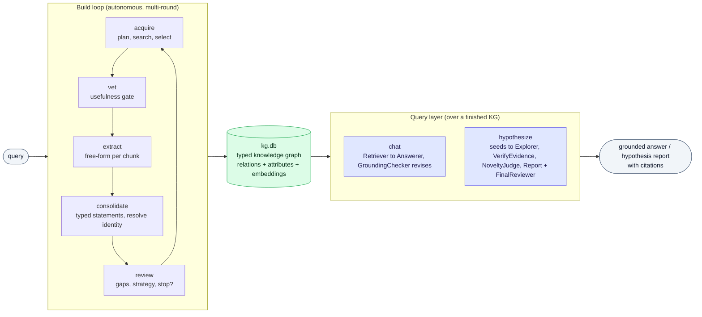

# memex

**Multi-agent knowledge graphs for hypothesis generation.**

memex reads a corpus about a topic, distils it into a typed knowledge graph in
which every fact points back to the sentence it came from, and then reasons over
that graph: it answers questions with citations and proposes new, evidence-backed
hypotheses for a researcher to check.

The name comes from Vannevar Bush's 1945 essay *As We May Think*, which imagined
a "memex": a desk that held everything a researcher had read and let them follow
associative trails through it.

This is a research prototype, shared as a source of ideas. It works end to end,
but it is not a maintained product. The [design notes](docs/design-notes.md)
explain what was tried, what worked and what didn't. For a quick overview, see
the 15-slide deck: [PDF](docs/deck/memex-deck.pdf) ·
[web](https://kairat-rakhimov.github.io/memex/deck/).

---

## What it does

memex has two halves around one SQLite file per graph (`kg/<kg_id>/kg.db`):

**The build loop** grows a graph from a seed query, round by round, with no
reading list and no fixed length:

1. a *RoundPlanner* ranks the topics to pursue next;
2. per-source *QueryPlanners* turn them into arXiv, Wikipedia and GDELT queries;
3. a *Selector* picks the few documents worth their cost, and a
   *UsefulnessGate* reads each one whole before letting it in;
4. an *Extractor* pulls claims out in the text's own words; a *Mapper* and an
   *AttributeMapper* turn them into typed relations (entity → entity) and
   attributes (entity → value + unit + condition); a *MappingReviewer* sends bad
   mappings back;
5. a *Resolver* merges duplicate entities across the whole graph;
6. a *KGReviewer* reports where the graph is thin, and a *Strategist* decides
   what the next round should chase, or stops the build when returns dry up.

**The query layer** runs read-only over a finished graph. Thin agents call a
deterministic toolbox of symbolic, semantic and graph-topology retrieval:

- **`chat`** — a tool-using *Retriever* gathers evidence, an *Answerer* writes
  only from it, and a *GroundingChecker* verifies every claim against its source
  sentence, forcing a rewrite when one isn't supported.
- **`hypothesize`** — structural seeds (bridges between distant concepts, missing
  links, outlier values, contested values or relations) point an *Explorer*
  agent at promising spots; it reads the source sentences and proposes a
  testable hypothesis or gives up. *VerifyEvidence* re-checks each one, a
  *NoveltyJudge* scores whether it says anything the corpus doesn't already
  state, and a *ReportWriter* / *FinalReviewer* pair writes the ranked report.

Every agent call — prompts, response, tokens, timing — is stored in the same
`kg.db`, and `memex ui` lets you browse it.



Full technical reference: [docs/architecture/](docs/architecture/INDEX.md).

## Quick start

Requires Python 3.11+ and [uv](https://docs.astral.sh/uv/), plus an API key for
OpenAI or any OpenAI-compatible endpoint.

```bash
git clone https://github.com/kairat-rakhimov/memex.git && cd memex
```

```bash
uv sync
```

```bash
cp .env.example .env   # then set OPENAI_API_KEY
```

### Try it on the demo graph (no build needed)

The demo graph is a 24-round build on *green hydrogen production*: the 64
shareable documents of the original 88 (39 Wikipedia articles and the 25 arXiv
papers under open licenses), 9,203 entities,
11,875 relations and 5,831 measured attributes. It is
[hosted on Hugging Face](https://huggingface.co/datasets/krakhimov/memex-green-hydrogen)
(≈285 MB, CC BY-SA 4.0).

```bash
uv run memex fetch-demo
```

```bash
uv run memex chat green-hydrogen -q "What drives down the levelised cost of green hydrogen?"
```

```bash
uv run memex hypothesize green-hydrogen --seed-type bridge
```

```bash
uv run memex ui   # http://127.0.0.1:8001 — build trace, graph view, query reasoning
```

`chat` and `hypothesize` only read the graph; each run costs a few LLM calls.
See [examples/](examples/) for full outputs and their agent traces.

### Build your own graph

```bash
uv run memex build solid-state --query "solid-state battery electrolytes" \
    --max-rounds 3 --docs-per-round 4
```

Then `chat`, `hypothesize` and `ui` work on `solid-state` the same way. A
stopped build resumes where it left off when you run the same command again.

**Cost and time.** Builds are LLM-heavy: each ingested document is read whole,
extracted chunk by chunk, mapped, reviewed and resolved. The demo graph's
original build (88 documents, 24 rounds) made about 4,900 LLM calls using 30M
prompt tokens (16M of them served from the prompt cache) and 5M completion
tokens. At OpenAI list prices for `gpt-4.1` and `gpt-5.1` that is roughly
**$75, or about $0.85 per document**, and it took about 6 hours (≈14 minutes per
round of 5 documents). A one-round, one-paper build
(`--max-rounds 1 --docs-per-round 1 --sources arxiv`) took under 6 minutes and
about $0.95, and turned the paper into 163 entities, 187 relations and 94
measured attributes. Budget roughly $1 per ingested document; the example above
ingests up to 12. Without `--max-rounds`, a build runs until the Strategist stops
it (at most 40 rounds).

**Better PDF parsing (optional).** Run a [GROBID](docs/grobid.md) container to
split arXiv papers along their sections instead of pdfminer's flat text:

```bash
docker compose up -d grobid && export MEMEX_GROBID_URL=http://localhost:8070
```

## Commands

| Command | What it does |
|---|---|
| `memex build <kg_id> --query "…"` | Grow a graph from a seed query (resumable). |
| `memex chat <kg_id> -q "…"` | Grounded answer with an evidence table and citations. |
| `memex hypothesize <kg_id> [--seed-type …]` | Ranked, evidence-backed hypotheses. Seed types: `bridge`, `gap`, `property`, `attribute_contested`, `relation_contested`. |
| `memex ui` | Browse build traces, the graph and query reasoning in the browser. |
| `memex inspect <kg_id>` | The build trace in the terminal (rounds, failures, single calls). |
| `memex fetch-demo` | Download the demo graph. |
| `memex serve` | HTTP API: `POST /run` with `{"input": {"task": "chat" \| "hypothesize" \| "build", …}}` — see [examples/requests/](examples/requests/). |

Every command takes `--help`.

## Configuration

Settings come from the environment or `.env`; [.env.example](.env.example)
documents each one.

| Variable | Default | Purpose |
|---|---|---|
| `OPENAI_API_KEY` | — | Required. |
| `OPENAI_BASE_URL` | OpenAI | Any OpenAI-compatible endpoint. |
| `MEMEX_CHAT_MODEL` | `gpt-4.1` | Planning, querying, extraction, answering. |
| `MEMEX_REASONING_MODEL` | `gpt-5.1` | Whole-document reading, mapping, reviewing, hypotheses. |
| `MEMEX_EMBEDDING_MODEL` | `text-embedding-3-large` | Entity resolution and semantic retrieval. |
| `MEMEX_KG_DIR` | `kg` | Where graphs live. |
| `MEMEX_CONTACT` | — | Contact for the public APIs' User-Agent (Wikipedia asks for one). |
| `MEMEX_GROBID_URL` | — | Enables GROBID PDF parsing. |
| `SAMPLE_MODE` | `false` | Replace every LLM call with a deterministic stub (offline plumbing checks). |

## Repository layout

```
memex/
  kg_intelligence/   build loop: agents, round graph, source adapters (arxiv, wikipedia, gdelt)
  kg_query/          query layer: retrieval toolbox, seeds, scoring, chat + hypothesize agents
  observability/     kg.db schema and store (graph + full build trace)
  ui/                memex ui (build trace browser + query reasoning viewer)
  cli/               the memex command
  api.py, run_router.py   HTTP API
experiments/         per-agent A/B harnesses used during development
scripts/             maintenance tools (slim export, vocabulary re-clustering)
examples/            outputs, agent traces and API requests from the demo graph
docs/                architecture, design notes, GROBID, slide deck
tests/               offline test suite
```

## Development

```bash
uv run pytest
```

```bash
uv run ruff check .
```

The test suite runs offline in about ten seconds: LLM calls are stubbed and
source APIs are mocked. `SAMPLE_MODE=true` runs the whole build loop against
stubs, which is useful for plumbing changes; source adapters still hit the
public APIs.

## More

- [Design notes](docs/design-notes.md) — decisions, experiments and measurements.
- [Architecture](docs/architecture/INDEX.md) — the build pipeline and query layer in detail.
- Slide deck — a 15-slide overview: [PDF](docs/deck/memex-deck.pdf) ·
  [web](https://kairat-rakhimov.github.io/memex/deck/) (source in [docs/deck/](docs/deck/)).
- [Third-party notices](NOTICE.md).

## License

Code: [MIT](LICENSE). The demo graph: CC BY-SA 4.0, with per-document
attribution in its dataset card. Text fetched by your own builds stays under its
original license.

If memex is useful in your work, see [CITATION.cff](CITATION.cff).
