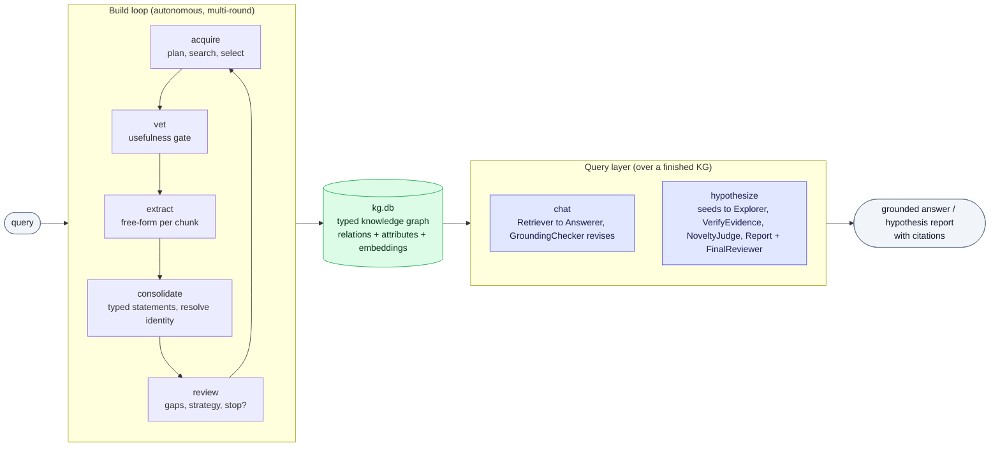

# memex architecture

*Last updated: 2026-11-26*

> Living sources: [`memex/`](../../memex/) (code is source-of-truth) and
> [`docs/design-notes.md`](../design-notes.md) (design rationale). This set synthesises them
> into one narrative; it does not replace them.

## What memex is

memex is a multi-agent knowledge-graph system for **hypothesis generation**. It stands on
two legs:

- a **self-calibrating knowledge harvester** that reads a corpus and distils it into a typed,
  grounded knowledge graph (`kg.db`), and
- a **query layer** that runs over that graph to answer questions with citations and to
  propose new, grounded hypotheses.

## The documents

| Doc | What it covers |
|---|---|
| [build-pipeline.md](build-pipeline.md) | The harvester (left leg): the multi-round build flow, the `kg.db` store, and a per-piece reference for all ~13 build agents and gates. |
| [query-layer.md](query-layer.md) | The query layer (right leg): the chat and hypothesize flows, the deterministic retrieval/grounding/seeds/scoring toolbox, and the 9 query agents. |
| **this file** | The system map, how the legs connect, the multi-agent-collaboration map, the runtime interface, and configuration. |

## The data substrate (`kg.db`)

Both legs meet at one SQLite database per graph, at `<MEMEX_KG_DIR>/<kg_id>/kg.db`
(`MEMEX_KG_DIR` defaults to `kg`). The downloadable demo graph (`memex fetch-demo` →
`kg/green-hydrogen/kg.db`, on "green hydrogen production") holds **64 documents (39
Wikipedia + 25 openly licensed arXiv papers), 9,203 entities, 11,875 relations, and 5,831
attributes**, with 1,024-dim embeddings.

**Typed statements**, not generic triples — knowledge is stored in two lanes:

- **Relations** (`kg_relations`): entity → predicate → entity, where both endpoints are real
  rows in `kg_entities` (`canonical_name`, `entity_type`, `mentions`, `degree`).
- **Attributes** (`kg_entity_properties`): entity → property → structured value, with
  `value_num`, `unit`, and `condition` as separate columns — so "491 mV" is a queryable
  measurement, not a string, and measured facts stay out of the relation graph.

Each statement carries a `mapper_confidence` and a `mapped_flag` (whether its vocabulary was
canonicalized or committed raw).

**The grounding ladder.** Every statement stores three provenance levels, so any claim
resolves to its source:

- **L1 canonical** — the synonym-merged statement (also what is embedded).
- **L2 raw** — the Extractor's surface form (`raw_subject`/`raw_predicate`/`raw_object`,
  `raw_property`/`raw_value`).
- **L3 source span** — the verbatim `source_quote`, plus `source_chunk_id` →
  `chunks.char_start/end` → `documents.text`.

Plus the document citation (`documents.metadata`) and a read-time corroboration count
(distinct source documents asserting the same canonical fact).

**Canonical vocabulary + clusters.** Predicates, entity types, and property types are
canonicalized into `kg_schema`. The post-build VocabResolver adds two non-destructive
overlays: `predicate_aliases` / `property_aliases` (synonym → canonical) and `schema_parents`
(child → parent specialization). The query layer's expansion reads both.

**Embeddings.** Six kinds are stored — `relation`, `attribute`, `entity`, `predicate`,
`property`, `chunk` (1024-dim in the demo graph) — so facts, not just text, are embedded
and semantic retrieval works over relations and attributes directly.

## Multi-agent collaboration

The agents on both legs collaborate through feedback loops — delegation, critique,
revision, verification, and shared memory, all visible in the JSONL traces. The principal
loops:

| Pattern | Where |
|---|---|
| **Critique → revise** | MappingReviewer → Mapper re-map (build); GroundingChecker → Answerer redraft (chat); FinalReviewer → ReportWriter revise (hypothesize) |
| **Adversarial verification** | VerifyEvidence rejecting unsupported hypotheses; the MappingReviewer's `unfaithful` drop |
| **Deterministic validation (with retry)** | the FORM/value gate sending a malformed statement back for a bounded re-map; the dedup and tier-1 resolve gates |
| **Dynamic delegation / steering** | the Strategist seeding the next round's plan and abandoning mined-out themes; the tool-using Retriever and Explorer choosing their own lookups (ReAct) |
| **Shared memory** | `kg.db` — the accumulating graph the build agents read the state-so-far from, and the query layer runs over |

The build-loop trace lives in each graph's `kg.db`; the query traces live next to it in
`<kg_id>/query_trace.db`. Both are browsable in the unified UI (below). Every run also writes
a flat JSONL agent trace to `LOG_DIR` (default `logs/`); captured examples are in
[`examples/traces/`](../../examples/traces/).

## Runtime interface

- **CLI** — one `memex` command (`memex/cli/`): `build` grows a graph from a seed query,
  `chat` asks a grounded question, `hypothesize` runs a hypothesis sweep, `fetch-demo`
  downloads the demo graph, `inspect` prints a build's trace in the terminal, `ui` serves the
  trace browser, and `serve` runs the HTTP API.
- **`POST /run`** (`memex serve`, port 8000 by default) — the HTTP entry point
  (`memex/run_router.py`). The request's `input.task` selects one of three workflows:
  - `build` — a small harvest from `input.query` (all sources, tight caps, wall-clock guard).
  - `chat` — grounded Q&A over the graph named by `input.kg_id`.
  - `hypothesize` — a hypothesis sweep over the graph named by `input.kg_id`.

  Each returns a structured JSON response (machine fields + a human `report_markdown`) and
  writes a JSONL agent trace to `LOG_DIR`. The endpoint enforces a configurable request
  timeout (`RUN_TIMEOUT_SECONDS`). Example requests are in
  [`examples/requests/`](../../examples/requests/).
- **`GET /health`** — liveness; makes no LLM call.
- **Graphs** — `chat` / `hypothesize` read `<MEMEX_KG_DIR>/<kg_id>/kg.db`; `build` writes a
  new graph there (under `input.kg_id`, or a generated id).
- **UI** — `memex ui` serves a read-only viewer (port 8001, `--kg-root kg` by default) with
  both the build-loop trace (`/build`) and the query-reasoning trace (`/query`) for every
  graph under the root.

## Configuration

| Concern | How it is configured |
|---|---|
| **LLM access** | Any OpenAI-compatible endpoint via `OPENAI_API_KEY` / `OPENAI_BASE_URL`. Models: `MEMEX_CHAT_MODEL` (default `gpt-4.1`), `MEMEX_REASONING_MODEL` (`gpt-5.1`), `MEMEX_EMBEDDING_MODEL` (`text-embedding-3-large`). All agents are built by `build_llm_model` (`memex/kg_intelligence/agents/base.py`) at temperature 0. |
| **Graph location** | `MEMEX_KG_DIR` (default `kg`); one `<kg_id>/kg.db` per graph. |
| **PDF parsing** | GROBID when `MEMEX_GROBID_URL` is set (see [`docs/grobid.md`](../grobid.md) and `compose.yaml`); otherwise pdfminer. |
| **Server** | `memex serve` (`HOST` / `PORT`, default `127.0.0.1:8000`); `/health` is a pure liveness check. The `Dockerfile` runs the same server on `0.0.0.0:8000`. No GPU is needed. |
| **Secrets** | `.env` is gitignored; `.env.example` lists the variables with placeholders only. |
