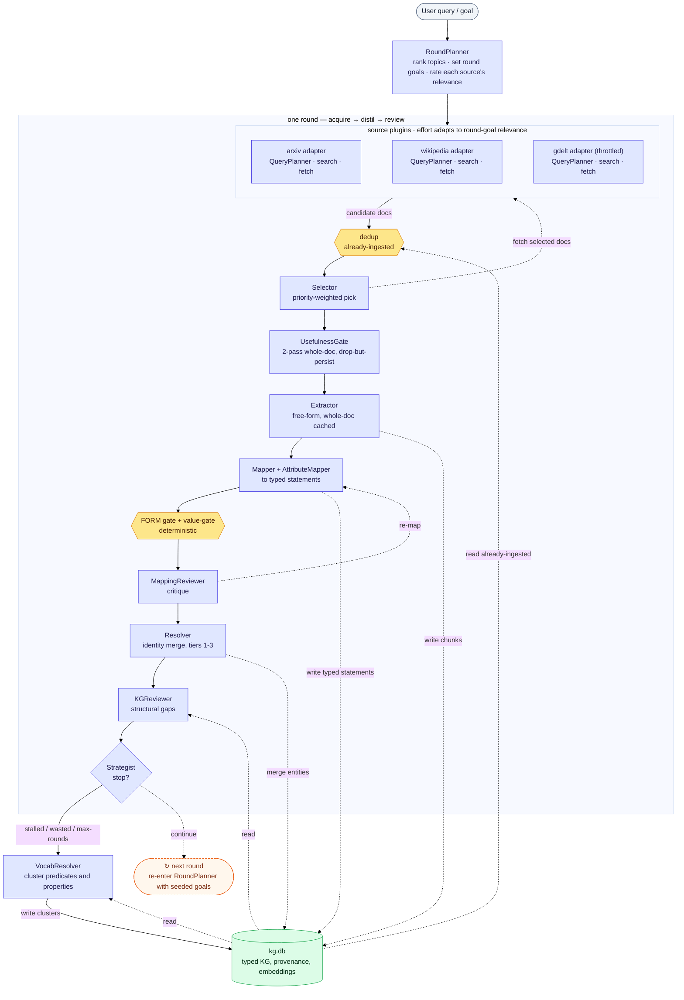

# The knowledge-graph build pipeline

*Last updated: 2026-11-26*

> Living sources: [`memex/kg_intelligence/`](../../memex/kg_intelligence/) (code is
> source-of-truth) and [`docs/design-notes.md`](../design-notes.md) (rationale). This doc
> synthesises them into one narrative; it does not replace them.

## 1. Overview

memex stands on two legs. This document is the **left leg — the knowledge harvester**:
the half that goes out, reads a corpus, and distils it into a typed, grounded knowledge
graph (`kg.db`). The **right leg — the [query layer](query-layer.md)** — is what then
puts that graph to work, answering questions and proposing hypotheses. Neither leg is
worth much alone: a harvester with nothing reading from it, a query layer with nothing to
read.

The harvester is **self-calibrating** and **multi-agent**. *Multi-agent:* a dozen
specialised agents — a planner, per-source searchers, a usefulness judge, an extractor, two
mappers, reviewers, a resolver, a strategist — each own one decision and collaborate
through the shared graph, several **critiquing and revising** each other's work.
*Self-calibrating:* nobody hands it a reading list or tells it when to stop. It reads what
it found, judges where the graph is still thin, **retargets its own search at those gaps**,
and **halts itself** when fresh reading stops adding anything. Point it at one seed query
and it harvests until the topic is saturated.

The original 88-document build on "green hydrogen production" did exactly that — over 24
rounds it acquired and distilled **88 documents into 11.3k entities, 15k relations, and
7.8k structured attributes**, then stopped on its own saturation signal: no fixed length,
no human in the loop. The downloadable demo graph (`memex fetch-demo`) keeps the 64
redistributable documents of that build (39 Wikipedia + 25 openly licensed arXiv papers):
9,203 entities, 11,875 relations, and 5,831 attributes.

### 1.1 How it steers itself

Each round pursues a **plan** — a ranked set of topics to chase. A relay of agents searches
for those topics, vets and reads what comes back, and folds it into the graph (*plan →
search → select → gate → extract → map → review → resolve*; §2 walks it). On round 1 the
plan is exploratory, decomposing the query into facets; every round after, it is directed.

What directs it is the **Strategist**. At each round's end it judges the build's recent
trajectory — a trend across rounds, not a single round — and steers the next: it marks which
themes are paying off, pushes weak ones down, and **abandons** themes that recur without
landing anything new (an abandoned theme is excluded from every later round). It stops the
build when the trajectory has gone *stalled* or *wasted*. So every plan after the first is
shaped by the whole history so far — the open gaps, the subtopics already covered, the themes
given up on — and the harvester keeps moving into new territory rather than re-searching old
ground.

Work also flows backward inside a round: a reviewer can send a document back to be
re-mapped, and the resolver merges entities across the whole round's haul. §2 follows each
of these.

### 1.2 `kg.db` is the build's memory

There are no per-document scratch files: `kg.db` is the one durable store. It holds the
accumulating typed knowledge (relations and attributes), the full provenance of every
statement (which document, which chunk, which agent call produced it), and the embeddings
used for retrieval and near-duplicate detection. Within a round the agents pass their
products to each other in memory; what lands in `kg.db` is the committed knowledge and its
provenance. The agents that need the graph *so far* read it from there — the Mapper pulls
the current canonical vocabulary, the Resolver the existing entities, the dedup gate the
already-ingested set, the planner the open gaps — so the build's state is the database, not
process memory. That is also what lets a run checkpoint and resume mid-build.

Keeping the graph, embeddings, and provenance in one store is what gives the query layer its
reach: it can combine **symbolic, semantic, and topological** retrieval in a single line of
reasoning — graph math grounded in meaning, such as finding two entities linked through a
shared intermediate yet far apart in embedding space — with every result traceable to its
source sentence.

*The build round: agents (blue), deterministic gates (amber), and the `kg.db` store
(green). Within a round the agents run top-to-bottom; the Strategist either starts another
round (back to the RoundPlanner) or hands off to finalization; the dotted arrows are the
backward and store read/write flows.*

---

## 2. The phases of a round

A round runs as a relay: each agent does one job and passes its result to the next. Several
steps also hand work *back* — returning a document to be redone, or shaping the next round's
plan.

**Plan — the RoundPlanner sets the agenda.** A round opens with the RoundPlanner turning the
build's accumulated state into a ranked list of topics to chase: the Strategist's goal
directives, the open structural gaps, the subtopics already covered or still missing, and
the themes marked abandoned (which it excludes). Round 1, with none of that history yet,
decomposes the user's query into facets.

**Search — each source is a plugin.** memex is **source-blind**: every corpus sits behind a
uniform adapter, and the pipeline iterates whatever adapters registered at startup — it
never names a source. Three ship today — arXiv (papers), Wikipedia (background), GDELT (news
and events) — and adding a fourth is a new plugin, not a pipeline change. Not every source
runs every round: the RoundPlanner rates each one's corpus-fit for the round's topics
(`high` / `medium` / `low`), and a *throttled* source — GDELT, which is rate-limited — sits
the round out unless it's rated `high`, so a scarce source is spent only when it's likely to
pay. The sources that do act don't share a query language, so each adapter carries its own
QueryPlanner (`QueryPlanner[arxiv]`, `[wikipedia]`, `[gdelt]`) that translates the round's
topics into that source's dialect, runs them, and screens the hits for relevance, returning
a pool of candidate documents.

**Select — dedup, then the Selector picks.** A deterministic **dedup gate** first discards
anything already in the graph. The surviving pool goes to the Selector, which weighs all
candidates across sources against the round's priorities and picks the few worth the
expensive steps ahead. There is no per-source quota — the choice is global.

**Gate — the UsefulnessGate reads each document whole.** Each selected document is fetched
in full and read by the UsefulnessGate in one reasoning-model pass. For every document it
keeps, it writes a summary and a corpus reflection: the summary is stored and later grounds
the query layer's answers and reports; the reflection — what the corpus now covers and
still misses — feeds the next RoundPlanner. A document that adds nothing is skipped, which
spares the round the cost of extraction and mapping. Most documents are kept.

**Extract — the Extractor reads for meaning.** The Extractor works through the document
chunk by chunk and pulls out every claim it finds, in free form — "X reduces Y," "the
measured cost was Z" — against no schema. Each chunk is read in the context of the whole
document, which rides along as a cached prefix (read once and reused, not re-sent per
chunk). The output is raw; the Mapper structures it next.

**Map — the Mapper and AttributeMapper impose structure.** Two agents turn the free-form
text into a *typed* graph, one per kind of fact. The **Mapper** handles relationships
between entities (entity → predicate → entity); the **AttributeMapper** handles measured
properties (entity → property → value, with the number, unit, and condition kept separate
and queryable). Keeping measurements in their own lane stops "491 mV" from becoming a node
in the graph. Between mapping and commit, a deterministic **FORM gate + value-gate** rejects
malformed statements.

**Review-mapping — the MappingReviewer can send it back.** The MappingReviewer checks the
Mapper's canonical choices against a fixed failure-mode checklist — over-collapse (a specific
predicate flattened into a generic one), wrong direction, type mismatch, or unfaithful — and
flags the offending **statements**, not the whole document. In the original 88-document build it caught
the Mapper collapsing `contains_impurity` ("carbon monoxide is an impurity in hydrogen") into
a generic `contains`, and turning a raw `does_not_require` (a noble-metal catalyst) into
`required_for`, which both flipped the direction and dropped the negation. Flagged statements
go back for a bounded **re-map** with the reviewer's note as feedback; an `unfaithful` verdict
drops them instead. Either way it is a revise action recorded in the trace.

**Resolve — the Resolver merges duplicate entities.** Documents mention "green hydrogen,"
"green H₂," and "renewable hydrogen" as separate entities; the Resolver decides which are the
same and merges them. It works against the **whole accumulated graph**, not just this round:
each round it matches the round's new entities against every existing one — so a new "green
H₂" merges with a "green hydrogen" from rounds ago — and every few rounds it re-sweeps the
entire graph. Candidate pairs come from name heuristics and embedding-similarity neighbours;
an exact-match tier merges them in deterministic code, the rest go to an LLM judge (§3 covers
the candidate filtering). It runs inside the round because it changes the graph's shape, which
later steps depend on.

**Review-graph — the KGReviewer finds the holes.** With the round's knowledge merged in, the
KGReviewer studies the graph — where it is thin, what is named but unexplained, which threads
dangle — and returns a ranked list of gaps. It reports; it does not modify the graph.

**Strategise — the Strategist decides and steers.** The Strategist judges the build's recent
trajectory — over a window of rounds, not just this one — together with the KGReviewer's
gaps, and either continues or stops. It stops when the build is *stalled* or *wasted*, the
clearest signal being a rising share of already-seen material across the window. It continues
by handing the next RoundPlanner per-theme directives — pursue, deprioritize, or abandon —
alongside the open gaps.

> *Mechanically the round runs in two phases. **Phase 1** — acquire through map-and-resolve —
> commits the round's knowledge to the graph and writes a checkpoint. **Phase 2** — the two
> reviews (KGReviewer, then Strategist) — runs after the commit. A build killed between them
> restarts straight into Phase 2 from the checkpoint. The stop is the Strategist's
> `stalled`/`wasted` call, with a zero-progress floor (3 barren rounds) and a 40-round
> ceiling as backstops.*

**Finalization — the VocabResolver tidies the vocabulary.** When the rounds stop, one pass
runs over the whole graph. Over many rounds the agents mint near-synonyms — `reduces`,
`lowers`, `decreases`. The VocabResolver clusters these and records that they are aliases
(and which predicates are special cases of which) as **metadata**; it never rewrites the
underlying statements. It runs once at the end because it only annotates.

## 3. Per-piece reference

Each entry is labelled **agent** or **gate**: an *agent* is an LLM call
(temperature 0, built by `build_llm_model`) that exercises judgment and appears in the trace under its name; a *gate*
is plain deterministic code that enforces a rule. Each entry gives the piece's contract and
rule, with a line of *why* only where a choice isn't self-evident.

**RoundPlanner** · agent · trace `RoundPlanner` · chat tier

Opens each round by turning the last round's review into a plan. **In:** the base
query, the KGReviewer's ranked structural gaps, the Strategist's goal directives
(`pursue` / `deprioritize`) and abandoned goals, and a one-line description of each
active source. **Out:** a `RoundPlan` — a ranked list of **3–6 topics** (each a short
noun phrase + one-line rationale; **priority = list order**) plus a `high`/`medium`/`low`
corpus-fit judgment for each source. It is **source-agnostic**: it names *what* the graph
should acquire next, never *how* to search for it — each adapter owns that. Rank-0 gaps map to the top topics; abandoned goals are hard-excluded; round 1
(no gaps yet) runs an exploratory decomposition of the query into facets; and if recent
rounds added no new documents, the prompt nudges it toward broader angles.

**Source adapters** · plugin layer (no model)

memex is source-blind: each corpus is a plugin implementing one `SourceAdapter` protocol
(`probe` / `plan_and_search` / `search` / `fetch`, plus a self-description), and an
`AdapterManager` probes the candidates once at startup and registers the ready ones by name —
the pipeline iterates `manager.active` and never names a source. Adding a source is a new
`sources/<name>/adapter.py` plus a factory entry (`memex/cli/build.py`), with no orchestrator
change. An adapter may hide internal backends behind its single identity — `ArxivAdapter`
searches the public Atom API and picks GROBID or pdfminer for PDF parsing from the
environment. Each adapter also declares a
**posture** (`relaxed` or `throttled`) that the relevance gate reads.

**QueryPlanner** (one per source) · agent · trace `QueryPlanner[arxiv|wikipedia|gdelt]` · chat tier

Translates the round's source-agnostic topics into queries that source actually
understands. Each adapter owns a `BaseQueryPlanner` whose prompt carries source-specific
phrasing guidance, so the arXiv planner writes paper-style queries and the GDELT planner
writes news-style ones. **In:** the ranked topics. **Out:** 1–6 query strings in priority
order. The shared `plan_and_search` wraps it with a **relevance posture**: a `throttled`
source (GDELT) makes *no* LLM call and *no* search unless the RoundPlanner rated it `high`
this round; a `relaxed` source always acts — how the build spends rate-limited sources
sparingly without any special-casing in the pipeline.

**Per-source ranker** · gate (deterministic) · no model

Before anything cross-source, each source's hits are re-sorted locally: 70% the source's
own relevance order + 30% a cheap native signal (arXiv abstract-overlap + recency,
Wikipedia length, GDELT recency + tone), top-20. Pure code, stamped as `rank_score` for
the trace — it thins each source's pool so the Selector reasons over the best of each,
not the raw firehose.

**Already-ingested dedup** · gate (deterministic) · no model

Drops any candidate already in `kg.db` before the Selector sees it — no LLM spent
re-judging a document a past round ingested. It also tallies how many surfaced candidates
were already-seen, per topic; that count becomes a saturation signal the Strategist reads
later.

**Selector** · agent · trace `Selector` · chat tier

The one place an arXiv paper is weighed against a GDELT article on a single axis. **In:**
the flat, deduped, per-source-ranked pool + the ranked topics + source descriptions + a
budget. **Out:** ≤budget picks by **priority-weighted goal-fit**, each stamped with a
`goal_relevance` score. No per-source quota — a round can be all Wikipedia or all arXiv if
that's where the value is. It leans toward the top topics, drops near-duplicates, and
explicitly *keeps* cross-source corroboration (the same finding from two sources is
corroboration, not duplication).

**Fetch** · adapters (I/O, no model)

Retrieves the full content of the selected candidates and chunks it (arXiv PDFs via
GROBID into section-aligned chunks when `MEMEX_GROBID_URL` is set — see
[`docs/grobid.md`](../grobid.md) — otherwise pdfminer flat text + a paragraph chunker;
Wikipedia and GDELT via their own fetchers), persisting one `ChunkedDoc` per success. Per-candidate failures are logged and
dropped — a source that 429s or times out simply contributes nothing that round, and the
build adapts around it.

**UsefulnessGate** · agent · trace `UsefulnessGate` · reasoning tier

One reasoning-model read of each fetched document, *whole* — two passes sharing a prompt
cache (the doc sits first, so pass 2 reuses pass 1's prefix). **Pass 1** scores `usefulness`
and returns a `keep`/`skip` verdict (keep ≥ 0.4). **Pass 2** runs for keepers and produces
the durable artifacts: a faithful summary plus the corpus reflection (entities seen,
subtopics covered/missing, borders). The summary is persisted to `doc_assessments` and
**grounds the query layer's downstream chat/report consumers**; the reflection folds into
corpus-state and steers the next RoundPlanner. Most documents pass — the gate earns its
whole-doc read mainly through that summary, and only secondarily by `skip`ping the rare
unhelpful doc *before* the costlier extraction + mapping. Every verdict, drops included, is
persisted (*drop-but-persist*). It judges *contribution to the graph*, not title-match, so
it keeps adjacent-field docs sharing mechanisms or materials. *(Replaced an earlier Reflector
that judged on the abstract alone.)*

**Extractor** · agent · trace `Extractor` · chat tier

The faithfulness pass: it reads the document chunk by chunk and emits entities, relations,
and attributes in the text's *own* surface vocabulary — **no canonical schema**; the Mapper
imposes structure later. It extracts only what the text explicitly
states (no outside knowledge) and normalizes every entity name and type to English,
translating non-English surface forms. In the default **session mode** the whole document
rides in a cached prefix (budgeted ~90k tokens, well under a 128k-token context window) so each chunk
is read with full-document context for the price of reading the doc once; an oversized doc
falls back to chunk-only extraction.

**Mapper + AttributeMapper** · agents · trace `Mapper` / `AttributeMapper` · reasoning tier

Where free-form text becomes a *typed* graph — two agents, two lanes. The **Mapper** (one
call per doc, with the whole doc + the current canonical vocabulary in context)
canonicalizes the *vocabulary* of relations — choosing a canonical predicate and
subject/object entity types per triple, with a `confidence`, a `newness` score, and a
`fallback_predicate` whenever it proposes a net-new canonical. It canonicalizes vocabulary
only — **entity identity stays with the Resolver**. The **AttributeMapper** owns the
attribute lane: it turns measured statements into structured properties (`property` +
`value_num` + `unit` + `condition`). Splitting the lanes is what keeps a measurement like
"491 mV" out of the relation graph as a fake entity — and across the corpus drove
measurement-leaf nodes to **0%**, relation purity to **100%**, and roughly **halved** the
predicate count versus free-form triples. Oversized docs degrade to triple-batch mapping so
a single whole-doc call never blows the context window.

**FORM gate + value gate** · gate (deterministic) · no model

The mechanical guarantee a prompt can't make. After the Mapper proposes canonicals, the
**FORM gate** admits a net-new predicate only if it clears strict form rules — no passive
voice, no clause-shaped predicate, English only — so a malformed predicate can *never*
enter the schema. A failure emits a precise per-triple violation that sends the Mapper back
for a **bounded re-map** (≤2 passes); if it still fails, the triple falls back to an
existing canonical, or commits raw and unmapped. Entity types and property names are
normalized to snake_case deterministically (no re-map needed). The **value gate** drops
vague or sentence-shaped attribute values *before* they can mint a property type, keeping
the attribute lane numeric and clean.

**MappingReviewer** · agent · trace `MappingReviewer` · reasoning tier

An adversarial check on the Mapper. It sees the canonical the Mapper chose, the deterministic
gate's decision, and the Mapper's confidence/newness scores, and is told to *find errors*
against a fixed failure-mode checklist, not to re-derive the mapping. Three modes —
**over-collapse** (a distinct predicate flattened to a generic one), wrong **direction**, and
**type** mismatch — route the flagged statements back for a **bounded re-map** (≤2 passes)
with the reviewer's note as feedback; a fourth, **unfaithful**, drops the statement outright
(folding the old separate triple-verification step into this review). It works per statement,
not per document.

**Resolver** · agent · trace `Resolver` · reasoning tier

Decides which entity mentions are the *same* thing and merges them — the one consolidation
step that changes the graph's shape. It runs over the **whole accumulated graph** (a snapshot
of every entity): each round it tests the round's new entities against all existing ones
(incremental), and every `SWEEP_PERIOD` rounds it re-examines all pairs (a full sweep).
Candidates come from three sources — **tier 1**, deterministic normalized-name collapses;
**tier 2**, an LLM judging pairs surfaced by name heuristics (Jaccard overlap, token-subset,
acronym); **tier 3**, an LLM judging embedding-similarity neighbours. Tier-2 and weak tier-3
pairs are kept only if the two entities **share a source document** (a cooccurrence filter);
a very-high-cosine tier-3 pair bypasses that, to catch cross-document spelling variants
(`electrolyzer` / `electrolyser`). Pairs judged distinct in a prior round are memoized out.
Every merge is auditable — a `merge` mutation plus an `endpoint_rewrite` per repointed
relation. It stays *inside* the round, not post-hoc, because it mutates graph topology that
everything downstream depends on.

**KGReviewer** · agent · trace `KGReviewer` · reasoning tier

After the round's knowledge is merged in, it studies the *graph* and returns a ranked list of
structural gaps (`KgGap`) — what's thin, named-but-unexplained, or left dangling. It makes no
stop decision and fixes nothing: pure structural analysis, whose ranked gaps are the raw
material the Strategist turns into the next round's plan.

**Strategist** · agent · trace `Strategist` · reasoning tier · *(code symbol `RoundReviewer`)*

The agent that owns the build's trajectory. Running in Phase 2 after the round's KG is
committed and its metrics row written, it reads the recent-round metric trend, the KGReviewer's
gaps, and its own cross-round goal memory, then does two things: **(a)** classifies the
trajectory and **owns the stop decision** — `stalled`/`wasted` ends the build (the genuine
saturation stop, backstopped by the zero-progress floor and the round ceiling); **(b)** seeds
the next RoundPlanner with per-theme directives (`pursue` / `deprioritize`) and marks
unanswerable goals as **abandoned** so they're never chased again. This is the agent that
closes the across-round flow.

**VocabResolver** · agent · trace `VocabResolver` · reasoning tier · *(finalization, post-loop)*

The Resolver's pattern applied to *vocabulary* instead of entities. Once the rounds stop, it
reads the whole accumulated canonical vocabulary, clusters near-neighbours by embedding
similarity, and asks the LLM to split each cluster's fuzzy proximity into three real
relationships: **alias** (true synonym → collapse), **child_of** (specialization → record the
broader term as a parent — the substrate the query layer later expands over), or **unrelated**
(leave standalone). It is **non-destructive by design**: it records cluster membership
(aliases and parents) as *metadata on the vocabulary*; the underlying statements and their
canonicals are never rewritten. It runs once at the end and not inside a round because it only
annotates, so nothing earlier in the build depends on it. A build that was stopped and resumed,
or interrupted before finalization, can be re-clustered in one clean pass over the complete
vocabulary with `scripts/kg_finalize_vocab.py <kg_id> --reset`. *(Predicate/property expansion then
happens at query time, not via a destructive merge — see the query-layer doc.)*
