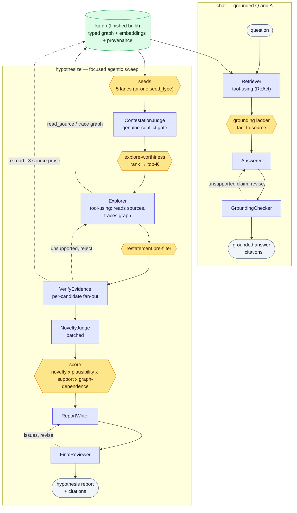

# The query layer

*Last updated: 2026-11-26*

> Living sources: [`memex/kg_query/`](../../memex/kg_query/) (code is source-of-truth) and
> [`docs/design-notes.md`](../design-notes.md) (rationale). This doc synthesises; it does not
> replace them. Companion to [build-pipeline.md](build-pipeline.md).

## 1. Overview

If the [build pipeline](build-pipeline.md) is memex's left leg — the knowledge harvester —
the **query layer is the right leg**: what puts the harvested graph to work. It never
touches the build; it runs read-only over a **finished** graph
(`<MEMEX_KG_DIR>/<kg_id>/kg.db` — e.g. the demo graph from `memex fetch-demo`) and does the
two things a researcher actually wants from a knowledge base: **answer questions with
citations**, and **propose new hypotheses** worth investigating. Two flows, one substrate.

On the demo graph, a chat question returns a synthesised answer backed by **a few dozen
cited evidence facts** — 40 in [`examples/chat.md`](../../examples/chat.md) — and revises
itself when a claim isn't supported; a hypothesis sweep —
focused on one structural lens via **`seed_type`** — sends a tool-using **Explorer** to
investigate the most promising seeds on the live graph and returns a handful of **grounded,
ranked hypotheses**, each with its supporting evidence and the duds filtered out or honestly
abandoned. Both are genuine multi-agent runs, and both emit a dual trace: the flat JSONL agent
trace (to `LOG_DIR`) and the inner-thinking query trace (`<kg_id>/query_trace.db`).

### 1.1 One spine: agents over a deterministic toolbox

Every query agent is thin; the heavy lifting is a **pure, deterministic toolbox** the
agents call (`memex/kg_query/`): retrieval (symbolic / semantic / topological), the grounding
ladder, vocabulary expansion, the hypothesis seeds, and the scoring. The same split that
runs through the build holds here — **agents exercise judgment, deterministic code does the
graph mechanics** — so the agents stay focused on language and reasoning, never on graph
traversal. Two agents are given the toolbox *as tools* — the chat **Retriever** and the
hypothesize **Explorer** — real tool-using ReAct agents that decide their own lookups (the
`run_tool_agent` seam), rather than running a fixed query.

### 1.2 Grounding is the through-line

Nothing ungrounded ships. Every claim an agent makes traces back to a specific **fact**,
and every fact traces to its **source** — the document, the chunk, and ideally the verbatim
sentence — through a three-level grounding ladder that already lives in the substrate (no
ingest changes). In chat, a dedicated GroundingChecker enforces it and can force a revision;
in hypothesize, each candidate's supporting "legs" are re-verified against the source prose
before it enters the report. In both flows grounding can send work back, rather than only
passing or failing at the end.

*The two flows over a finished `kg.db`. Agents (blue) call a deterministic toolbox (amber);
the dotted arrows are the feedback loops — GroundingChecker → Answerer, VerifyEvidence's
rejections, FinalReviewer → ReportWriter — plus the tool-using Explorer reading source prose /
tracing the graph and VerifyEvidence re-reading the source prose.*

## 2. The two flows

### 2.1 chat — grounded Q&A

A single turn, with no conversation history.

1. **Retriever** takes the question and gathers evidence — *as a tool-using agent*. It
   doesn't run one canned query; it issues graph / semantic / symbolic lookups against the
   toolbox, reads what comes back, and decides what to fetch next, until it has the facts it
   needs (bounded by a request limit). Its ReAct trajectory — each thought, tool call, and
   return — is captured in the query trace.
2. **ground_refs** turns the Retriever's selected references into a bundle of *grounded
   facts*: each fact resolved to its canonical statement, its source document, its
   corroboration count, and a citation, via the grounding ladder.
3. **Answerer** drafts an answer **strictly from that bundle** — synthesising across facts,
   citing each claim, and explicitly listing what the corpus *doesn't* cover rather than
   filling the gap from outside knowledge.
4. **GroundingChecker** reads the drafted answer against the same evidence and checks every
   claim. If any claim is unsupported, it issues a revision request and the **Answerer
   redrafts** — a real, bounded loop (default one revision) that fires only when grounding
   actually fails. The trace records the `needs_revision` → `retry` → approval handoff
   explicitly.

### 2.2 hypothesize — a focused, agentic sweep

hypothesize looks for non-obvious but defensible claims. The front is **bounded by
deterministic structure** (so the agent never free-roams "find me something interesting"); the
middle is a genuine **agentic investigation** of the few most promising spots.

1. **Seeds** — deterministic. The toolbox mines the graph for structurally interesting
   patterns across **five lanes** (bridges between distant subgraphs, structural gaps,
   statistical property outliers, contested attributes / relations), each carrying grounded
   supporting legs. Passing **`seed_type`** narrows this to one lane, so the Explorer's bounded
   budget goes *deep* on one structural lens rather than thin across all five.
2. **ContestationJudge** — one batched gate over the `relation_contested` seeds, which fire on
   predicate *count* and so conflate a genuine conflict (`increases` vs `replaces`) with synonym
   sprawl (`combined_with` / `integrates`) and compatible multi-facet relations. A seed it rules
   sprawl is heavily down-weighted in the next step, so it rarely earns exploration. (Embeddings
   can't make this call — they place antonyms adjacent.)
3. **Explore-worthiness ranking** — deterministic, *type-neutral*. Each seed is scored by how
   much **genuine, groundable** material surrounds it: the distinct documents its legs span (the
   strongest non-obviousness proxy — facts only ever co-stated in one place are an explicit link,
   not a discovery), the substance of its source sentences, and the genuineness gate. No lane or
   topic preference — the system never prefers a *kind* of hypothesis; it ranks "how much is
   here." The top-K most worthy seeds proceed.
4. **Explorer** — the agentic core, one tool-using ReAct investigation per top-K seed. It
   **reads the verbatim source sentences** (`read_source`), assembles numeric landscapes
   (`facts_by_property`), traces links (`connect_entities`, `entity_facts`) and reasons from what
   the papers *say*, then forms one grounded, testable hypothesis — or **bails** (`worthwhile=false`)
   if a few probes show a dud. Bounded by usage limits; stays anchored to the seed.
5. **Restatement pre-filter** — deterministic + cheap. A candidate that *grossly* restates an
   existing fact (by embedding) is dropped before it costs a verification.
6. **VerifyEvidence** — one call per surviving candidate; **re-reads the legs against the source
   prose** and rejects any resting on hallucinated/contradicted load-bearing legs (a critique
   handoff in the trace).
7. **NoveltyJudge** — one batched reasoning pass scoring each survivor's *assertional* novelty
   against its nearest facts — is the conclusion already asserted, or a genuine leap? — the
   meaning-level judgment embedding cosine can't make. Sees through elaboration: a wordy
   restatement of a definition scores low.
8. **Ranking** — deterministic: **novelty × plausibility × support × structure**, where
   `structure` is **graph-dependence** (the distinct documents the legs span — lane-blind), not a
   lane label. The top-N clear a floor; the rest fall to the appendix.
9. **ReportWriter ↔ FinalReviewer** — a bounded critique-and-revise loop that writes the
   curated report. It **always runs**, even when nothing survived: the fact that the
   verifier filtered candidates is itself a revision driver, so the report frames its
   survivors against what was rejected (and produces an honest exploration summary when the
   survivor set is empty). A deterministic appendix lists the full seed/candidate accounting.

## 3. Per-piece reference

### 3.1 The toolbox (deterministic — the agents call it; it never calls them)

**QueryDeps** · no model

The read-only handle to a finished `kg.db` for one run: opens the database, lazily builds
and caches the per-fact-kind embedding matrices and the NetworkX graph, and holds the
vocabulary-expansion maps. Every tool and agent in the run shares one instance; nothing
writes.

**Retrieval** · no model

Three modalities over the graph, each returning compact rows that carry a `(kind, fact_id)`
handle: **symbolic** (alias-aware SQL — entity by name, an entity's facts, facts by expanded
predicate/property), **semantic** (cosine of a query vector against the per-fact
relation/attribute embedding matrices — pure numpy, the caller supplies the vector), and
**topological** (NetworkX — neighbours, common neighbours, shortest paths, communities).
Results cap at small limits so a tool-using agent's context stays bounded.

**Grounding ladder** · no model

Turns a fact id into a `GroundedFact` carrying all three provenance levels the substrate
already stores: **L1** canonical (the synonym-merged, embedded sentence), **L2** raw (the
Extractor's surface form), **L3** source span (chunk → char offsets → document prose), plus
the document citation and a read-time corroboration count (how many distinct documents
assert the same fact). This is the gate that turns an id into quotable evidence — agents may
only cite ids the toolbox handed them, never invented ones.

**Expansion** · no model

Consumes the build's VocabResolver clusters at query time. The same relationship is spread
across synonym labels (`used_in` / `used_for` / `uses`) and specializations; symbolic retrieval
would miss a synonym-labelled edge unless the query label expands to its whole cluster.
Expansion does that, in trust order: the **alias** equivalence class
(`predicate_aliases` / `property_aliases`), then the **specialization rollup**
(`schema_parents` children — a broad query subsumes its narrower forms). The semantic lane
already clusters synonyms by embedding, so only the symbolic lane needs this.

**Seeds** · no model

Mines the graph for structurally interesting hypothesis starting points across **five
lanes**, each seed carrying its own grounded legs: **bridge** (two entities sharing an
intermediate but no direct edge, *distant* in concept space — the Swanson ABC pattern),
**gap** (same shape but *close* — an expected-but-missing link), **property** (numeric
distribution outliers + "different entities, same value" clusters), **attribute_contested**
(same entity + property, divergent values under different conditions), and
**relation_contested** (a pair joined by ≥2 predicates — the ContestationJudge later rules
whether they genuinely conflict or are just sprawl). Pure SQL + numpy + NetworkX — the
deterministic bound on the LLM fan-out.

**Scoring** · no model

Two deterministic, **lane-blind** scores. **`explore_worthiness`** (seed triage) predicts how
much investigating a seed will pay off — from type-neutral signals only: the distinct documents
its legs span (the strongest non-obviousness proxy), the substance of its source sentences, a
genuineness multiplier (a ContestationJudge-ruled sprawl seed is demoted), and a fluke-entity
floor. No lane/topic preference — it never favours a *kind* of hypothesis. **`composite_score`**
(final ranking) = **novelty × plausibility × support × structure**, where `structure` is
**graph-dependence** — the distinct documents the surviving legs span (1 source ⇒ ~0.5; 3+ ⇒
1.0), *not* a lane label. This replaced an earlier lane-keyed table (bridge=1.0 … property=0.55)
that baked in a preference for a kind of hypothesis; graph-dependence also subsumes the old
contested-sprawl and collapsed-bridge demotions (both reduce to "few distinct sources"). Novelty
comes from the **NoveltyJudge** (embedding novelty as fallback); the **restatement floor** is the
deterministic pre-filter that drops gross restatements before verification.

### 3.2 The agents (all reasoning tier)

**Retriever** · agent · trace `Retriever` · reasoning · *(tool-using, via `run_tool_agent`)*

One of the two tool-using agents (the other is the Explorer). Given the question it adaptively
composes the three retrieval modalities through `@agent.tool` wrappers over the pure toolbox —
issue a lookup, read the rows, decide the next — plus `read_source` to read the verbatim
sentence + context behind any fact when wording or conditions matter, and returns the fact refs
it judged relevant. The `run_tool_agent` seam (`kg_query/agents/runtime.py`) bounds the
ReAct loop with usage limits (request and tool-call caps — the main cost and latency lever),
persists the full thought / tool-call / return trajectory as the inner-thinking surface, and emits one **child** trace row per tool call (parent = the agent) so
the fan-out is a visible tree of tool calls.

**Answerer** · agent · trace `Answerer` · reasoning

Writes the answer from **only** the grounded bundle: every claim cites a `[n]` index into the
evidence, and anything the corpus can't support is listed under "not in corpus" rather than
written into the prose. On a grounding failure it redrafts against the checker's revision
request.

**GroundingChecker** · agent · trace `GroundingChecker` · reasoning

The adversarial verifier of the chat answer: for each claim it re-reads the cited evidence
and judges whether the bundle actually supports the assertion. An unsupported claim sends the
loop back to the Answerer for a bounded revision. *(Distinct from VerifyEvidence: this checks
answer-claims against the already-grounded bundle, not the source prose.)*

**ContestationJudge** · agent · trace `ContestationJudge` · reasoning

A **batched** gate over the `relation_contested` seeds. The lane fires on predicate *count*,
so it mixes a genuine conflict (`increases` vs `replaces` — the lead the lane exists for) with
synonym sprawl (`combined_with` / `integrates` / `produced_using` — all "uses") and
non-conflicting multi-facet relations (`adopts` / `defines` / `regulates`). The judge reads the
predicate set and rules each seed genuine or not; a non-genuine one keeps its hypothesis but
loses the contested structure bonus at scoring, so a dressed-up restatement of an obvious fact
can't lead on structure. Embeddings can't make this call — they place antonyms adjacent — so it
is a reasoning judgment, as the seed lane's design always intended.

**Explorer** · agent · trace `Explorer` · reasoning · *(tool-using, via `run_tool_agent`)*

The query layer's second tool-using agent and the hypothesize core. Handed ONE explore-worthy
seed, it **investigates it on the live graph** rather than reasoning one-shot from compressed
triples: `read_source` to read the verbatim source sentence + context (so it reasons from what
the papers *say*, not priors), `facts_by_property` to assemble a numeric landscape,
`entity_facts` / `connect_entities` / `search_facts` to pull related facts and trace links. It
then forms one grounded, testable hypothesis whose conclusion is an inferential leap beyond its
premises — or sets `worthwhile=false` and **bails** after a couple of probes if the seed is a
dud. Bounded by usage limits and anchored to the seed (the deterministic entry point keeps it
from free-roaming). Emits a child trace row per tool call, so the investigation is a visible
tree of tool calls. *(`seed_type` focuses the whole pool of Explorer runs on one lane, so a
bounded budget goes deep. The one-shot `HypothesisGenerator` is retained only as the
A/B baseline in `experiments/eval_hypothesize.py`, not in the live flow.)*

**VerifyEvidence** · agent · trace `VerifyEvidence` · reasoning

The per-candidate adversarial fan-out, one call per surviving hypothesis (one trace row
per candidate, the tightest per-leg grounding). It re-reads **each leg's L3 source prose**
and judges, leg by leg, whether the source actually supports it. Crucially it checks that the
premises are *real*, **not** that they prove the conclusion — a hypothesis is by design a leap
beyond its legs — so it rejects only when a *load-bearing* leg is hallucinated or contradicted
by its source. (This precision call was tuned on a live sweep: demanding the legs prove the
conclusion killed every real hypothesis.)

**NoveltyJudge** · agent · trace `NoveltyJudge` · reasoning

One **batched** call per sweep — all survivors and their nearest existing facts in a single
reasoning pass — scoring each hypothesis's *assertional* novelty: is its conclusion already
asserted/entailed by the near facts, or a genuine inferential leap beyond them? It replaces
embedding-cosine novelty in the composite because cosine measures *topical* similarity — a
hypothesis synthesised from existing facts reuses all their vocabulary, so it embeds close and
reads as a restatement even though its conclusion is stated nowhere (the contested/bridge leads
we most want on top scored *lowest* under cosine). Cosine also places opposites adjacent ("X
increases Y" ≈ "X decreases Y"), so it cannot tell a contested edge from an agreement; the
judge can. Embedding novelty remains the fallback (SAMPLE_MODE / judge error); the cheap
restatement pre-filter still runs first.

**ReportWriter** · agent · trace `ReportWriter` · reasoning

Writes the curated top-N researcher report from the ranked, verified hypotheses — each handed
to it with its lane, scores, verdict, and grounded evidence. It must cite sources and frame
every claim as a *hypothesis*, never a finding. *(The appendix of also-rans is rendered
deterministically, not by the model.)*

**FinalReviewer** · agent · trace `FinalReviewer` · reasoning

Audits the report before it ships — coverage (a spread of lanes), citations (every hypothesis
grounded), and over-claim (nothing stated as established fact). An unapproved review sends one
bounded revision back to the ReportWriter; and because the verifier's having filtered
candidates is itself a revision driver, this critique→revise cycle runs on **every** sweep,
not only when the reviewer dissents.
